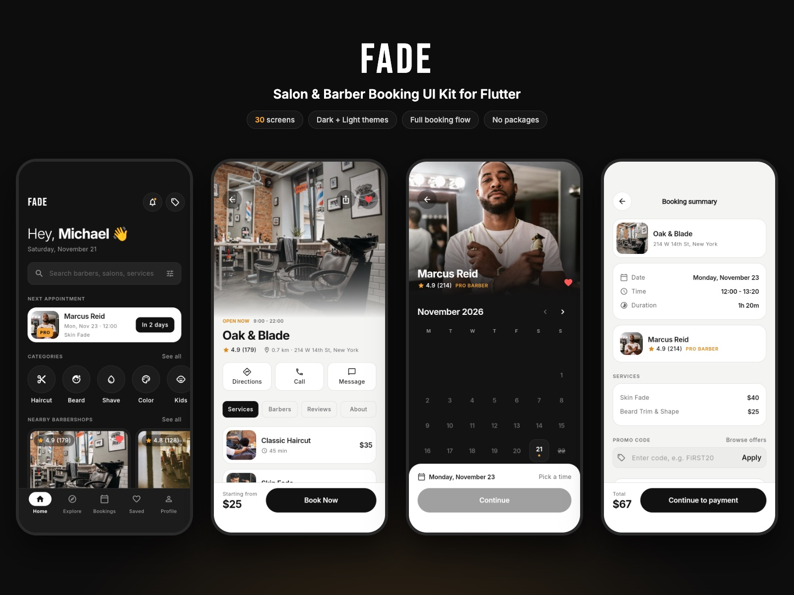

# Fade · Salon & Barber Booking UI Kit in Flutter

Fade is a salon and barber booking app UI kit built with Flutter. It has 30 screens, a complete booking flow and
both a dark and a light theme: find a barbershop, pick services, choose a barber, book a free time slot, pay, and
manage bookings, reviews, favourites and offers.

🌐 **Live demo:** https://yaqoobdeveloper.github.io/Fade-Salon-Barber-UI-Kit-in-Flutter/

🛒 **Get the UI kit with the full source code:** https://yaqoobdeveloper.com/ui-kits/fade-salon-barber-booking-ui-kit

📺 **More Flutter UI:** https://www.youtube.com/@yaqoob_developer

## Screens

- **Authentication:** Splash, Onboarding, Login, Sign Up
- **Discover:** Home, Search / Explore, Search Results (list and map), Salon Details, Services, Service Details
- **Booking flow:** Choose Barber, Date & Time, Booking Summary, Booking Success
- **Bookings:** My Bookings, Upcoming Booking, Booking Details, Cancel Booking
- **Payment:** Payment Method, Add Card, Payment Success
- **Profile:** Profile, Edit Profile, Notifications, Settings
- **Engagement:** Reviews & Ratings, Write Review, Favorites, Offers & Coupons, Empty State

## Highlights

- Dark and light themes, switchable in Settings
- Appointment calendar with closed days and taken time slots
- Promo codes, saved cards, wallets and "Pay at salon"
- Plain Flutter with no third-party packages

This repository only hosts the live demo. It does not contain the source code.
